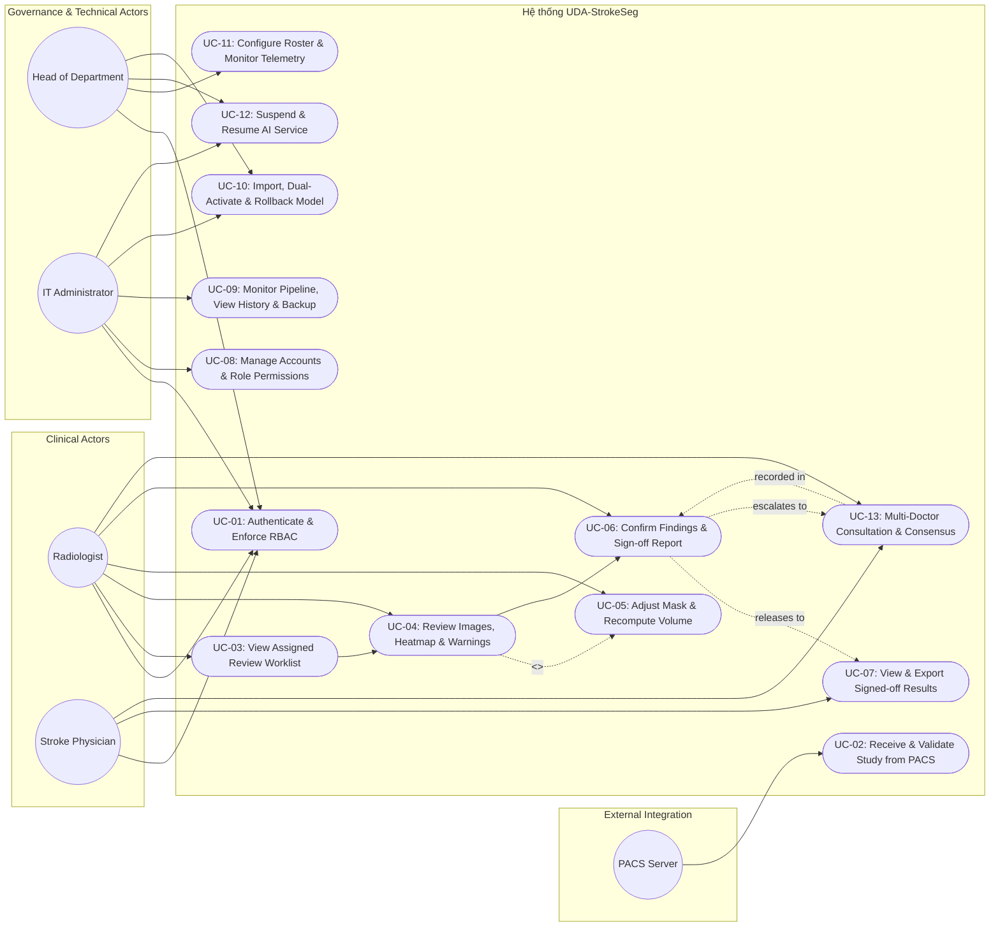

# UDA-StrokeSeg: Use Case Modeling & Detailed Specifications

Tài liệu này tổng hợp toàn bộ mô hình Use Case của hệ thống **UDA-StrokeSeg** (*An AI-based Diagnostic Support System for Acute Ischemic Stroke Using Lesion Segmentation on Multi-center MRI*), được chuẩn hóa từ Báo cáo Chuyên đề tốt nghiệp (Chương 4 & Chương 5).

---

## 1. Actor Catalog (Danh mục Tác nhân)

Hệ thống phân định ranh giới trách nhiệm nghiêm ngặt giữa các vai trò lâm sàng, quản trị vận hành và hệ thống tích hợp bên ngoài:

| Tác nhân (Actor) | Phân loại | Vai trò & Phạm vi quyền hạn trong hệ thống |
| :--- | :--- | :--- |
| **Radiologist** (Bác sĩ CĐHA) | Primary Clinical Actor | Đọc chuỗi ảnh MRI đa xung (DWI, ADC, FLAIR), xem bản đồ xác suất và mặt nạ dự đoán tổn thương của AI; chỉnh sửa viền tổn thương (HITL) khi cần; ghi nhận chẩn đoán sơ bộ lâm sàng (*Preliminary Diagnostic Impression*); ký duyệt và phát hành báo cáo ca bệnh (*Sign-off Report*). **Đây là tác nhân duy nhất có thẩm quyền ký duyệt ca bệnh.** |
| **Stroke Physician** (Bác sĩ Đột quỵ / Thần kinh) | Primary Clinical Actor | Tiếp nhận báo cáo và kết quả đã được Radiologist ký duyệt (*Signed-off*) để phối hợp phân tích cùng bệnh cảnh lâm sàng, thời gian khởi phát và chống chỉ định điều trị; tham gia các phiên hội chẩn. **Không có quyền chỉnh sửa mask hay ký duyệt báo cáo CĐHA.** |
| **Head of Department** (Trưởng khoa / Quản trị lâm sàng) | Clinical Governance | Quản trị danh sách bác sĩ đủ điều kiện đọc ca (*Reviewer Roster*); thiết lập chính sách phân công và quy tắc leo thang ca trễ hạn (*Escalation rules*); giám sát dashboard tải công việc và tỷ lệ chấp thuận AI; kích hoạt ngắt mạch tạm dừng dịch vụ AI khi có sự cố an toàn lâm sàng; phê duyệt quyết định phát hành lâm sàng cho phiên bản model AI mới (*Clinical Release Approval*). **Không có quyền duyệt ca hay sửa mask.** |
| **IT Administrator** (Quản trị viên Hệ thống) | Technical Administration | Quản lý tài khoản và phân quyền RBAC; giám sát kỹ thuật, hạ tầng, hàng đợi, độ trễ và sự cố bảo mật; cấu hình kết nối PACS; sao lưu và phục hồi thảm họa ngoài luồng (*Out-of-band / CLI Restore*); nhập gói mô hình (*Model Package Import*), kiểm tra sẵn sàng kỹ thuật và kích hoạt/rollback model; tạm dừng dịch vụ AI khi có sự cố kỹ thuật. **Tuyệt đối không có thẩm quyền lâm sàng.** |
| **PACS** | External System | Hệ thống lưu trữ và truyền hình ảnh y tế của bệnh viện. Tự động đẩy các chuỗi ảnh DICOM (DWI, ADC, FLAIR) vào hệ thống qua tài khoản dịch vụ chuyên dụng (*Submit-only service account*). **Không có quyền xem kết quả hoặc truy cập giao diện duyệt ca.** |

---

## 2. Use Case Diagram (Mermaid)

Sơ đồ thể hiện 12 ca sử dụng chính của hệ thống và ca sử dụng mở rộng cho hội đồng hội chẩn (*Consultation*):



---

## 3. Detailed Use Case Specifications (Đặc tả chi tiết)

### UC-01: Authenticate and Enforce Role-Based Access
* **Mã Use Case:** UC-01
* **Tác nhân:** Radiologist, Stroke Physician, Head of Department, IT Administrator.
* **Mô tả:** Xác thực người dùng bằng thông tin định danh cá nhân, khởi tạo phiên làm việc bảo mật (JWT Bearer Token), phân quyền theo vai trò (RBAC) và tự động khóa phiên sau 15 phút không thao tác (*idle timeout*).
* **Tiền điều kiện:** Tài khoản người dùng đã được IT Administrator khởi tạo và cấp quyền hợp lệ (UC-08).
* **Hậu điều kiện:** Người dùng truy cập đúng phân hệ chức năng tương ứng với vai trò. Sự kiện đăng nhập thành công hoặc thất bại đều được ghi vào Audit Log.
* **Luồng sự kiện chính (Main Flow):**
  1. Người dùng nhập Username và Password trên giao diện đăng nhập.
  2. Hệ thống kiểm tra thông tin đăng nhập trong cơ sở dữ liệu (`USER_ACCOUNT`, `USER_ROLE`).
  3. Xác thực thành công, hệ thống cấp JWT Token (thời hạn 900 giây) chứa danh sách vai trò và quyền hạn.
  4. Hệ thống điều hướng người dùng đến Workspace tương ứng.
  5. Mọi thao tác sau đó đều được kiểm tra phân quyền tại API Gateway theo nguyên tắc *Deny by Default*.
  6. Sau 15 phút không phát sinh tương tác (chuột/bàn phím), phiên làm việc tự động hết hạn (*Idle Timeout*).
* **Luồng ngoại lệ (Alternative/Exception Flows):**
  * *2a. Sai thông tin xác thực:* Trả về thông báo lỗi chung (*Generic Error*) "Invalid credentials" để tránh lộ thông tin tài khoản tồn tại; ghi nhận sự kiện `LOGIN_FAILED`.
  * *4a. Truy cập trái phép:* Người dùng cố truy cập API ngoài phạm vi phân quyền &rarr; Server trả về `403 Forbidden` và ghi vết `ACCESS_DENIED`.
  * *5a. Hết hạn phiên:* Người dùng phải đăng nhập lại. Các thay đổi chưa lưu trên giao diện vẽ mask sẽ bị hủy.
  * *5b. Ca cấp cứu:* Khi người dùng đang mở xem ca cấp cứu đọc khẩn cấp, cơ chế keep-alive sẽ duy trì phiên làm việc liên tục.

---

### UC-02: Receive and Validate a Study from PACS
* **Mã Use Case:** UC-02
* **Tác nhân:** PACS (Hệ thống bên ngoài qua tài khoản dịch vụ chuyên trách).
* **Mô tả:** Hệ thống tiếp nhận chuỗi ảnh DWI, ADC, FLAIR của một ca chụp gửi tự động từ PACS qua giao thức DICOM C-STORE, tiến hành tiền kiểm tra chất lượng hình học (QC), làm sạch siêu dữ liệu (sanitization) và đẩy tác vụ phân tích AI vào Event Bus.
* **Tiền điều kiện:** Kết nối PACS và tài khoản Service Account đã được cấu hình; dịch vụ AI đang ở trạng thái hoạt động (*ACTIVE*).
* **Hậu điều kiện:** Ca bệnh hợp lệ được chuyển sang trạng thái `Processing` và đưa vào hàng đợi AI. Ca lỗi chuyển sang trạng thái `Failed` (lý do: `validation failed` hoặc `processing failed`) và chuyển vào Quarantine Log, tuyệt đối không xuất hiện trên Worklist của bác sĩ.
* **Luồng sự kiện chính (Main Flow):**
  1. PACS gửi lệnh `cStore(seriesList)` chứa 3 chuỗi xung DWI, ADC, FLAIR.
  2. Dịch vụ Intake tạo bản ghi ca bệnh với trạng thái `Received`.
  3. Hệ thống kiểm tra tính đầy đủ của 3 xung, tính nhất quán hình học, ma trận Affine, độ phân giải voxel và định dạng kích thước.
  4. Tiền kiểm tra thành công, hệ thống chuyển ảnh DICOM thành định dạng NIfTI, lưu vào Object Storage và lấy về file checksum/URL.
  5. Trạng thái ca bệnh chuyển sang `Processing`.
  6. Intake phát sự kiện `StudyValidated` lên Event Bus (Pub/Sub) và phản hồi `C-STORE Success (0x0000)` về PACS.
  7. Worker AI nhận tác vụ, kích hoạt đồng hồ đếm ngược 180s SLA qua Circuit Breaker, thực hiện tiền xử lý, chạy mô hình suy luận UDA segmentation và tính toán thể tích tổn thương trong không gian gốc (*native space*).
  8. Xử lý thành công trong 180s, Worker lưu mask và chỉ số đo đạc vào Object Storage & Database, cập nhật trạng thái ca bệnh sang `AwaitingReview` và phát sự kiện `InferenceCompleted`.
* **Luồng ngoại lệ (Alternative/Exception Flows):**
  * *3a. Lỗi hình học hoặc thiếu xung:* Ca bệnh chuyển sang trạng thái `Failed` (lý do: `validation failed`), ghi nhận vào `QuarantineLog` và phản hồi mã lỗi DICOM `0xC000`. Không đưa vào hàng đợi AI.
  * *7a. Quá thời gian xử lý AI (> 180s SLA Timeout):* Circuit Breaker kích hoạt ngắt mạch, hủy tác vụ AI worker, đánh dấu trạng thái ca là `Failed` (lý do: `processing failed`), bắn cảnh báo `SLATimeout` lên Ops Dashboard và đẩy ca sang luồng đọc thủ công khẩn cấp (*Manual Reading*).

---

### UC-03: View Assigned Review Worklist
* **Mã Use Case:** UC-03
* **Tác nhân:** Radiologist.
* **Mô tả:** Bác sĩ CĐHA xem danh sách các ca bệnh đang ở trạng thái chờ duyệt (`AwaitingReview`) được phân công riêng cho mình theo chính sách phân bổ của Trưởng khoa.
* **Tiền điều kiện:** Radiologist đã đăng nhập hợp lệ và có tên trong danh sách Reviewer Roster đang kích hoạt.
* **Hậu điều kiện:** Không có dữ liệu ca bệnh nào bị thay đổi.
* **Luồng sự kiện chính (Main Flow):**
  1. Radiologist mở giao diện Worklist.
  2. Hệ thống kiểm tra ID bác sĩ và trả về danh sách các ca bệnh được gán có trạng thái `AwaitingReview`.
  3. Radiologist chọn một ca bệnh cụ thể để mở màn hình đọc ảnh (chuyển sang UC-04).
* **Luồng ngoại lệ (Alternative/Exception Flows):**
  * *2a. Không có ca bệnh:* Hệ thống hiển thị bảng trống.
  * *2b. Truy cập ca của bác sĩ khác:* Bị hệ thống từ chối và ghi vết kiểm toán.
  * *2c. Bác sĩ bị xóa khỏi Roster:* Hệ thống khóa truy cập Worklist và thông báo liên hệ Trưởng khoa.

---

### UC-04: Review Images, Heatmap, Overlay, and Warnings
* **Mã Use Case:** UC-04
* **Tác nhân:** Radiologist.
* **Mô tả:** Radiologist kiểm tra trực quan các lát cắt đồng bộ của chuỗi xung DWI, ADC, FLAIR cùng với bản đồ nhiệt xác suất AI, lớp phủ viền tổn thương (mask overlay), thông số đo đạc thể tích và các cảnh báo chất lượng để hình thành nhận định chẩn đoán sơ bộ.
* **Tiền điều kiện:** Ca bệnh đang ở trạng thái `AwaitingReview` và được phân công cho chính Radiologist đó.
* **Hậu điều kiện:** Dữ liệu ca bệnh không đổi. Radiologist có thể chuyển tiếp sang chỉnh sửa mask (UC-05) hoặc tiến hành ký duyệt (UC-06).
* **Luồng sự kiện chính (Main Flow):**
  1. Hệ thống hiển thị đồng bộ đa khung nhìn (Synchronized Viewports) cho 3 chuỗi xung DWI, ADC, FLAIR theo từng lát cắt.
  2. Radiologist bật/tắt lớp phủ bản đồ xác suất tổn thương và viền mặt nạ, điều chỉnh độ mờ (opacity) và cửa sổ hiển thị (Window/Level).
  3. Hệ thống hiển thị nhãn cảnh báo: *"AI output is decision-support information, not an autonomous clinical diagnosis"*, đi kèm phiên bản model AI và phạm vi khuyến cáo sử dụng.
  4. Hệ thống hiển thị các thông số định lượng: Tổng thể tích tổn thương (mL), số lượng ổ tổn thương (Cluster count), vị trí bán cầu (Laterality) và vùng cấp máu động mạch.
* **Luồng ngoại lệ (Alternative/Exception Flows):**
  * *2a. Mặt nạ dự đoán rỗng (Empty Mask):* Hệ thống thông báo rõ mặt nạ rỗng không đồng nghĩa với kết luận âm tính (bình thường), yêu cầu bác sĩ vẫn phải đọc kỹ toàn bộ lát cắt.
  * *4a. Lỗi tính toán chỉ số:* Hiển thị thông báo lỗi thay vì giá trị số; ngăn chặn ký duyệt cho đến khi chỉ số được tính toán lại thành công.

---

### UC-05: Adjust a Mask and Recompute Measurements
* **Mã Use Case:** UC-05
* **Tác nhân:** Radiologist.
* **Mô tả:** Bác sĩ CĐHA sử dụng các công cụ vẽ (Brush, Eraser, Contour threshold) để hiệu chỉnh viền tổn thương do AI dự đoán (Human-in-the-loop). Mỗi lần lưu sẽ sinh ra một phiên bản mặt nạ bất biến mới (immutable revision) và tự động tính toán lại thể tích tổn thương.
* **Tiền điều kiện:** Radiologist đang mở xem ca bệnh hợp lệ từ UC-04.
* **Hậu điều kiện:** Phiên bản mặt nạ mới (`Revision N+1`) được lưu trữ, giữ nguyên bản gốc AI; các chỉ số thể tích tổn thương được tính toán lại tương ứng; ca bệnh vẫn ở trạng thái `AwaitingReview`.
* **Luồng sự kiện chính (Main Flow):**
  1. Radiologist chọn công cụ chỉnh sửa (Brush / Eraser / Threshold).
  2. Radiologist thao tác chỉnh sửa trực tiếp trên từng lát cắt ảnh.
  3. Radiologist nhấn "Lưu bản chỉnh sửa" và nhập lý do điều chỉnh viền.
  4. Hệ thống kiểm tra phiên bản gốc (`base_mask_id`) để đảm bảo không bị xung đột phiên bản.
  5. Hệ thống lưu file NIfTI mask mới vào Object Storage, tạo bản ghi revision mới trong database và ghi vết chênh lệch thể tích (`DiceDiff`, `VolumeChange`).
  6. Hệ thống tự động kích hoạt tính toán lại thể tích trong không gian gốc và cập nhật lại giao diện.
* **Luồng ngoại lệ (Alternative/Exception Flows):**
  * *3a. Xung đột phiên bản (Stale Revision):* Nếu ca bệnh đã có bản lưu mới hơn từ phiên làm việc khác &rarr; Hệ thống trả về `409 Conflict`, từ chối ghi đè và yêu cầu tải lại trang.
  * *3b. Bỏ trống lý do:* Hệ thống từ chối lưu và yêu cầu nhập lý do điều chỉnh bắt buộc.
  * *3c. Hết phiên (Session Expired):* Hủy các thao tác chưa lưu, yêu cầu đăng nhập lại (UC-01).

---

### UC-06: Confirm Clinical Findings & Sign-off Report
* **Mã Use Case:** UC-06
* **Tác nhân:** Radiologist.
* **Mô tả:** Radiologist nhập nhận định chẩn đoán sơ bộ (*Preliminary Diagnostic Impression*), xác thực danh tính bước hai (*Step-up Re-authentication*), đóng băng kết quả và ký duyệt báo cáo chính thức. Sau khi ký duyệt, kết quả là bất biến và sẵn sàng cho Bác sĩ điều trị xem xét.
* **Tiền điều kiện:** Ca bệnh đang ở trạng thái `AwaitingReview`; Radiologist được phân công ca bệnh và đã hoàn thành đọc ảnh qua UC-04.
* **Hậu điều kiện:** Trạng thái ca bệnh chuyển sang `SignedOff`; mặt nạ và chỉ số đo đạc bị khóa bất biến; bản ghi phản hồi AI (`ClinicalFeedback`) được lưu; báo cáo chính thức được phát hành cho Stroke Physician. Ca bệnh đã ký duyệt tuyệt đối không thể mở lại hay chỉnh sửa.
* **Luồng sự kiện chính (Main Flow):**
  1. Radiologist mở biểu mẫu ký duyệt cho phiên bản mask hiện tại.
  2. Radiologist nhập nội dung nhận định chẩn đoán sơ bộ.
  3. Radiologist nhấn "Xác nhận và Ký duyệt báo cáo".
  4. Hệ thống yêu cầu nhập lại mật khẩu xác thực bước hai (*Step-up Token* có hạn 5 phút).
  5. Hệ thống khóa mặt nạ hiện tại, gắn thẻ trạng thái tiếp nhận AI:
     * `accepted_unchanged`: Chấp thuận 100% kết quả AI ban đầu.
     * `accepted_with_adjustment`: Chấp thuận sau khi đã điều chỉnh qua UC-05.
  6. Hệ thống chuyển trạng thái ca bệnh sang `SignedOff`, lưu chữ ký số và sinh mã phiên bản báo cáo.
  7. Trình tạo báo cáo biên dịch file PDF chính thức có đầy đủ thông số lâm sàng và lưu vào Object Storage.
* **Luồng ngoại lệ (Alternative/Exception Flows):**
  * *1a. Không sử dụng kết quả AI (Do not use AI result):* Bác sĩ nhận định AI sai hoàn toàn, chọn không dùng AI &rarr; Bắt buộc nhập lý do từ chối. Bác sĩ tự đọc ca độc lập; báo cáo xuất bản sẽ không chứa các chỉ số do AI tính toán.
  * *2a. Thiếu nhận định chẩn đoán sơ bộ:* Hệ thống chặn ký duyệt.
  * *4a. Xác thực bước hai thất bại:* Trả về `401 Unauthorized`, hủy tiến trình ký duyệt.
  * *5a. Phiên bản lỗi thời:* Phát hiện mask đã bị thay đổi trước khi ký &rarr; Báo lỗi, yêu cầu nạp lại ca.

---

### UC-07: View and Export Signed-off Results
* **Mã Use Case:** UC-07
* **Tác nhân:** Stroke Physician.
* **Mô tả:** Bác sĩ điều trị đột quỵ mở xem kết quả ca chụp đã được ký duyệt chính thức bởi Radiologist, tham khảo các chỉ số thể tích tổn thương và tải file báo cáo PDF có mã phiên bản để phục vụ hội chẩn và ra quyết định điều trị.
* **Tiền điều kiện:** Stroke Physician đã đăng nhập hợp lệ; ca bệnh đã ở trạng thái `SignedOff`.
* **Hậu điều kiện:** Không làm thay đổi dữ liệu ca bệnh; lượt tải báo cáo được ghi vào Audit Log.
* **Luồng sự kiện chính (Main Flow):**
  1. Stroke Physician mở danh sách ca bệnh lâm sàng đã hoàn tất.
  2. Hệ thống hiển thị nhận định chẩn đoán của Radiologist, thể tích tổn thương (mL), số lượng ổ, vùng cấp máu và hình ảnh các chuỗi xung MRI kèm mask đã duyệt.
  3. Hệ thống hiển thị thông tin bác sĩ ký duyệt, thời gian ký và tuyên bố từ chối trách nhiệm (*Disclaimer*).
  4. Bác sĩ nhấn "Tải báo cáo PDF".
  5. Hệ thống sinh URL tải an toàn (Presigned URL có hạn 15 phút) và ghi nhận sự kiện `REPORT_ACCESSED`.
  6. Bác sĩ tải file PDF hoàn chỉnh.
* **Luồng ngoại lệ (Alternative/Exception Flows):**
  * *1a. Ca bệnh chưa ký duyệt hoặc đã thất bại:* Hệ thống từ chối truy cập (`403 Forbidden`), tuyệt đối không để lộ bản nháp (DRAFT) cho bác sĩ điều trị.

---

### UC-08: Manage User Accounts and Role Permissions
* **Mã Use Case:** UC-08
* **Tác nhân:** IT Administrator.
* **Mô tả:** Quản trị viên IT tạo mới, cập nhật, kích hoạt hoặc vô hiệu hóa tài khoản nhân sự và phân bổ quyền hạn theo đúng yêu cầu phê duyệt từ tổ chức.
* **Tiền điều kiện:** IT Administrator đăng nhập thành công với quyền `admin:provision`.
* **Hậu điều kiện:** Tài khoản được cập nhật; mọi thay đổi về phân quyền được ghi vết kiểm toán.
* **Luồng sự kiện chính (Main Flow):**
  1. IT Administrator mở màn hình Quản lý tài khoản.
  2. Nhập thông tin nhân viên (Mã nhân viên, Tên đăng nhập, Mật khẩu ban đầu) và gán vai trò tương ứng.
  3. Hệ thống lưu tài khoản vào cơ sở dữ liệu (`USER_ACCOUNT`, `USER_ROLE`).
  4. Hệ thống ghi nhận sự kiện `ACCOUNT_PROVISIONED` vào Audit Log.
* **Luồng ngoại lệ (Alternative/Exception Flows):**
  * *2a. Trùng lặp Username:* Báo lỗi, yêu cầu chọn tên khác.
  * *3a. Admin tự gán vai trò lâm sàng:* Hệ thống lập tức chặn hành động (`403 Forbidden`) vì vi phạm nguyên tắc tách biệt quyền hạn; ghi vết `PRIVILEGE_VIOLATION_BLOCKED`.

---

### UC-09: Monitor Pipeline, View Case History, and Perform Backup/Recovery
* **Mã Use Case:** UC-09
* **Tác nhân:** IT Administrator.
* **Mô tả:** Giám sát thời gian thực trạng thái vận hành của hệ thống (hàng đợi ca, độ trễ, tài nguyên phần cứng, lỗi suy luận) mà không xem nội dung ảnh bệnh nhân; xem lịch sử kiểm toán dạng chỉ đọc (*Read-only Audit Log*); thực hiện sao lưu tự động và phục hồi hệ thống khi có sự cố.
* **Tiền điều kiện:** Đăng nhập dưới quyền IT Administrator.
* **Hậu điều kiện:** Nhật ký và trạng thái vận hành được rà soát; bản sao lưu được bảo toàn.
* **Luồng sự kiện chính (Main Flow):**
  1. IT Administrator mở Ops Dashboard.
  2. Hệ thống hiển thị số liệu ca tiếp nhận, ca đang xử lý, ca chờ duyệt, ca lỗi kèm mã lỗi chi tiết và biểu đồ độ trễ 180s SLA.
  3. Quản trị viên tra cứu lịch sử vòng đời của một ca bệnh cụ thể từ Audit Log.
  4. Kích hoạt sao lưu định kỳ hoặc sao lưu khẩn cấp cơ sở dữ liệu và kho đối tượng.
  5. Trong trường hợp thảm họa máy chủ (Server Crash), quản trị viên thực hiện phục hồi dữ liệu từ tầng hạ tầng thông qua giao diện dòng lệnh độc lập (*CLI / Bastion Host*).
* **Luồng ngoại lệ (Alternative/Exception Flows):**
  * *2a. Vi phạm ngưỡng SLA (> 180s):* Dashboard hiển thị cảnh báo đỏ và ghi nhận sự kiện vi phạm ngưỡng.
  * *4a. Sao lưu thất bại:* Hệ thống bắn thông báo lỗi quản trị và không đánh dấu bản sao lưu là khả dụng.

---

### UC-10: Import, Dual-Activate, and Rollback a Model Version
* **Mã Use Case:** UC-10
* **Tác nhân:** IT Administrator, Head of Department.
* **Mô tả:** Nhập gói mô hình AI được đóng gói offline; áp dụng cơ chế phê duyệt kép (*Dual-Authorization Gate*: Trưởng khoa duyệt lâm sàng + IT Admin duyệt kỹ thuật) trước khi kích hoạt; hỗ trợ rollback tức thì về phiên bản cũ an toàn.
* **Tiền điều kiện:** Mô hình đã được huấn luyện và đóng gói offline kèm Manifest hợp lệ.
* **Hậu điều kiện:** Phiên bản mô hình mới được kích hoạt (*ACTIVE*), worker AI nạp trọng số mới; hoặc hệ thống hoàn nguyên về phiên bản cũ. Các báo cáo lịch sử vẫn giữ nguyên định danh model tại thời điểm tạo.
* **Luồng sự kiện chính (Main Flow):**
  1. IT Administrator tải lên gói mô hình AI kèm file checksum và manifest.
  2. Hệ thống xác thực mã băm SHA-256 và đăng ký phiên bản với trạng thái ban đầu là `INACTIVE`.
  3. Head of Department kiểm tra báo cáo kết quả UDA và xác nhận phê duyệt lâm sàng (`CLINICAL_GATE_APPROVED`).
  4. IT Administrator kiểm tra khả năng tương thích phần cứng, bộ nhớ GPU và xác nhận phê duyệt kỹ thuật (`TECHNICAL_GATE_APPROVED`).
  5. Khi cả 2 phê duyệt hợp lệ, hệ thống cho phép kích hoạt phiên bản model.
  6. AI Worker tiến hành tải trọng số mới vào bộ nhớ GPU (*Hot Reload*) và ghi vết `MODEL_ACTIVATED`.
* **Luồng ngoại lệ (Alternative/Exception Flows):**
  * *1a. Sai lệch mã băm (Checksum Mismatch):* Hệ thống hủy bỏ tiếp nhận gói model.
  * *5a. Thiếu 1 trong 2 phê duyệt:* Hệ thống từ chối kích hoạt (`400 Bad Request`). Không một tác nhân đơn lẻ nào có thể tự ý kích hoạt model.
  * *7a. Yêu cầu Rollback:* IT Admin chọn một phiên bản đã được duyệt trước đó &rarr; Hệ thống lập tức hoàn nguyên phiên bản model mà không làm thay đổi các báo cáo đã ký trước đây.

---

### UC-11: Configure Reviewers, Assignment, and Queue Monitoring
* **Mã Use Case:** UC-11
* **Tác nhân:** Head of Department.
* **Mô tả:** Trưởng khoa quản lý danh sách bác sĩ đủ điều kiện tham gia đọc ca (Reviewer Roster), cấu hình thuật toán phân bổ ca bệnh, ngưỡng cảnh báo leo thang ca trễ hạn và theo dõi các chỉ số chấp thuận kết quả AI ở mức tổng hợp.
* **Tiền điều kiện:** Đăng nhập dưới quyền Head of Department.
* **Hậu điều kiện:** Chính sách phân ca mới có hiệu lực; các chỉ số thống kê được bảo vệ quyền riêng tư (triệt tiêu hiển thị nhóm nhỏ < 5 để tránh soi xét cá nhân).
* **Luồng sự kiện chính (Main Flow):**
  1. Trưởng khoa mở màn hình Quản trị Roster & Điều phối.
  2. Thêm hoặc loại bỏ bác sĩ CĐHA khỏi danh sách Reviewer đang hoạt động.
  3. Thiết lập quy tắc phân ca tự động (xoay vòng hoặc theo tải công việc) và thời gian cảnh báo trễ hạn.
  4. Xem báo cáo tổng hợp: Tỷ lệ chấp thuận AI không sửa (`accepted_unchanged`), tỷ lệ có chỉnh sửa (`accepted_with_adjustment`), và tỷ lệ từ chối (`not_used`).
* **Luồng ngoại lệ (Alternative/Exception Flows):**
  * *2a. Người dùng không có vai trò Radiologist:* Hệ thống chặn không cho thêm vào Roster.
  * *4a. Thống kê nhóm quá nhỏ:* Tự động ẩn số liệu đối với các nhóm dưới ngưỡng bảo mật để bảo vệ tính công bằng cho bác sĩ.

---

### UC-12: Suspend and Resume the AI Service
* **Mã Use Case:** UC-12
* **Tác nhân:** Head of Department (Lý do an toàn lâm sàng); IT Administrator (Lý do sự cố kỹ thuật).
* **Mô tả:** Tạm dừng khẩn cấp toàn bộ luồng xử lý AI khi phát hiện nguy cơ sai lệch chẩn đoán hoặc sự cố hạ tầng quá tải; điều hướng ca chụp mới về quy trình đọc thủ công tại PACS; khôi phục dịch vụ sau khi cả hai bên xác nhận đã khắc phục.
* **Tiền điều kiện:** Dịch vụ AI đang ở trạng thái hoạt động (đối với lệnh dừng) hoặc đang tạm dừng (đối với lệnh mở lại).
* **Hậu điều kiện:** Dịch vụ AI chuyển trạng thái `SUSPENDED`; các ca bệnh đang xử lý dở dang được bảo toàn trạng thái, không bị mất dữ liệu.
* **Luồng sự kiện chính (Main Flow):**
  1. Tác nhân có thẩm quyền phát hiện bất thường và nhấn nút "Tạm dừng dịch vụ AI" (Suspend).
  2. Nhập lý do tạm dừng bắt buộc và phạm vi áp dụng.
  3. Hệ thống chuyển trạng thái toàn cục sang `SUSPENDED` và phát sự kiện `ServiceSuspended`.
  4. Các ca chụp mới từ PACS được gắn nhãn đọc thủ công (*Manual Fallback*), không nạp vào worker AI.
  5. Đội ngũ kỹ thuật và lâm sàng điều tra sự cố; Head of Department ký nghiệm thu lâm sàng và IT Admin ký nghiệm thu kỹ thuật.
  6. Sau khi có đủ cả hai xác nhận, hệ thống cho phép khôi phục hoạt động bình thường.
* **Luồng ngoại lệ (Alternative/Exception Flows):**
  * *1a. Tác nhân không có thẩm quyền:* Bị từ chối quyền thực hiện.
  * *5a. Thiếu xác nhận nghiệm thu:* Dịch vụ tiếp tục duy trì trạng thái tạm dừng, ngăn chặn việc mở lại tùy tiện.

---

### UC-13: Multi-Doctor Consultation & Consensus (Use Case Mở rộng từ ERD)
* **Mã Use Case:** UC-13
* **Tác nhân:** Radiologist, Stroke Physician, Head of Department.
* **Mô tả:** Đối với các ca đột quỵ nặng, tổn thương diện rộng hoặc không điển hình, các bác sĩ cùng tham gia vào một phiên hội chẩn thời gian thực (*Consultationession*), xem chung hình ảnh MRI đa xung và viền tổn thương, ghi nhận ý kiến phản hồi lâm sàng (*ClinicalFeedback*) và đạt đồng thuận chung (*Consensus*) trước khi ra quyết định điều trị.
* **Tiền điều kiện:** Ca bệnh đã có ảnh và kết quả phân tích AI; phiên hội chẩn được khởi tạo từ Worklist hoặc do bác sĩ phụ trách yêu cầu.
* **Hậu điều kiện:** Bản ghi phiên hội chẩn (`Consultationession`), danh sách thành viên (`ConsultationMember`), điểm đánh giá độ hữu ích lâm sàng (`ClinicalUtilityRating`) và biên bản đồng thuận (`ConsensusNotes`) được lưu trữ vĩnh viễn trong cơ sở dữ liệu.
* **Luồng sự kiện chính (Main Flow):**
  1. Bác sĩ điều trị hoặc Bác sĩ CĐHA kích hoạt lệnh "Mở phiên hội chẩn" (*Trigger Consultation*) cho một ca bệnh phức tạp.
  2. Các thành viên hội đồng (Radiologist, Stroke Physician, Trưởng khoa) truy cập phiên làm việc chung qua giao thức thời gian thực (`PanelSession` / WebSocket).
  3. Hệ thống nạp chuỗi ảnh MRI gốc và các lớp mặt nạ phân vùng từ Object Storage (`FetchSeriesAndMasks`).
  4. Các bác sĩ trao đổi, ghi nhận đánh giá độc lập về độ chính xác của AI và phương án can thiệp.
  5. Trưởng phiên hội chẩn tổng hợp ý kiến, nhập biên bản kết luận đồng thuận (`ConsensusNotes`) và lưu vào cơ sở dữ liệu (`SaveConsensusFeedback`).
  6. Kết luận của hội đồng được chuyển tiếp sang bộ phận xuất báo cáo (`ForwardConsensus`) để hoàn tất hồ sơ ca bệnh.
* **Luồng ngoại lệ (Alternative/Exception Flows):**
  * *5a. Không đạt được đồng thuận:* Trưởng phiên ghi nhận trạng thái chưa đồng thuận (*Indeterminate / Disagreement*), chỉ định thực hiện thêm chụp cắt lớp vi tính mạch máu (CTA) hoặc kiểm tra lại chuỗi xung.
```

Tài liệu này bao quát các use case và phản ánh các điểm thống nhất về kiến trúc hệ thống:
- Thể hiện rõ mô hình **Event-driven (Pub/Sub)**, không sử dụng message queue truyền thống.
- Làm rõ cơ chế **SLA Timeout 180s** và luồng fallback sang chế độ đọc thủ công khẩn cấp.
- Tách biệt rõ giữa **Ops Dashboard** (giao diện UI) và tác vụ **Backup / Recovery** (chạy ngầm phía server/CLI).
- Đồng bộ các thực thể cơ sở dữ liệu trong ERD (`Consultationession`, `DomainAdaptationRun`, `ModelVersion`).